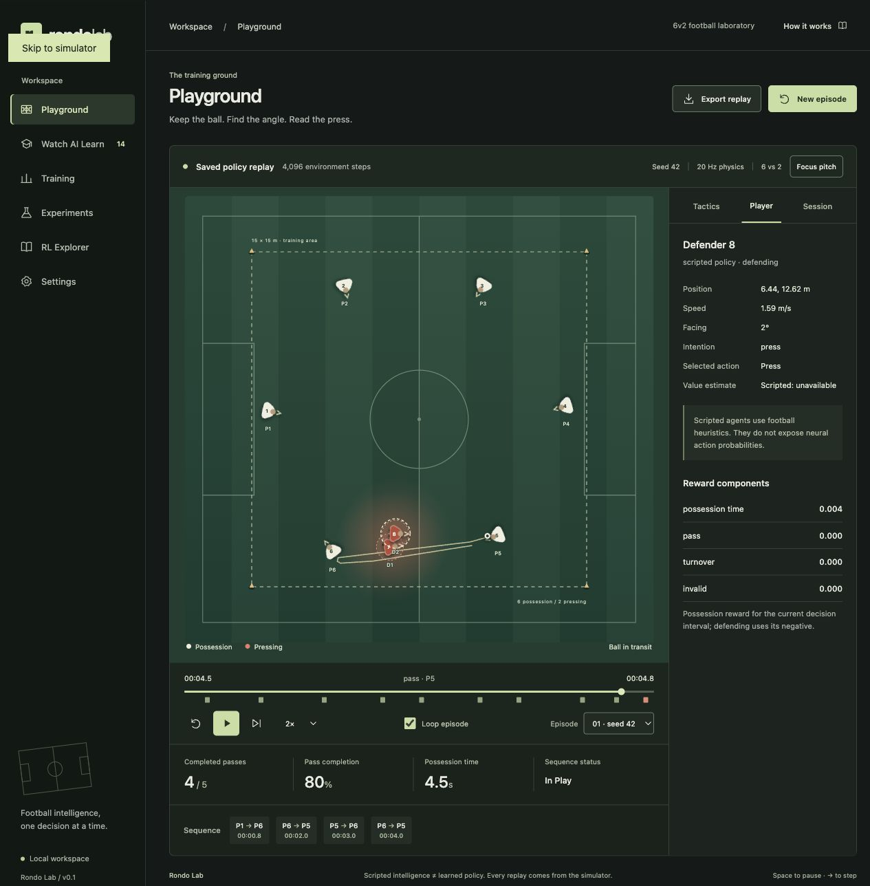

# Rondo Lab

A locally runnable 6v2 football rondo with continuous ball physics, scripted football agents, shared-policy PPO, recorded replays and an interactive React pitch.

Six possession players keep the ball from two pressing defenders. Start with the scripted drill, inspect a passing lane, change defender speed, then train a policy and compare its decisions from the same initial state.

## Install and launch

Requires Python 3.11+, [uv](https://docs.astral.sh/uv/) and Node.js 22+ (24 also works).

```bash
uv sync
npm ci --prefix frontend
./scripts/dev.sh
```

Open [Rondo Lab](http://127.0.0.1:5173). The app generates and plays a **scripted 6v2 episode immediately**. No model training is required. Backend docs are at [FastAPI docs](http://127.0.0.1:8000/docs).

For a single local server after building:

```bash
npm run build --prefix frontend
uv run uvicorn rondolab.api:app --host 127.0.0.1 --port 8000
```

Open [the built app](http://127.0.0.1:8000). Restart the backend after the first frontend build so the static mount is registered. Bind to localhost: this personal application has no authentication and is not intended for network deployment.

## First experiment

1. Watch the scripted match in Playground. A completed episode stops on a turnover or its time limit. Use Loop to repeat it, or New episode for another seeded initial state.
2. Open Session to change defender speed, ball speed, seed or strategy, then Generate episode.
3. Select a player to inspect position, velocity, facing and chosen action. Scripted players have no neural probabilities.
4. Open Training, select possession/basic and start a short 4096-step PPO run.
5. Open Watch AI Learn. Select the actual initialization, intermediate or final checkpoint, and optionally compare a second policy. Both start from the **same seed and current configuration**, with one synchronized timeline. Changing settings creates a deliberately different evaluation drill.
6. Inspect Experiments for actual logged evaluations. Final means training stopped, not that the policy is strong.

Space toggles playback when focus is outside a form control. Right arrow advances one 20 Hz frame. Timeline, speed, restart, episode selection, player inspection and all tactical layers operate on recorded states.

## CLI

```bash
# Scripted episode, with actual states, events and metrics
uv run python -m rondolab.demo --seed 42 --output examples/scripted.json

# Single-agent carrier decisions through a parameter-shared passing policy
uv run python -m rondolab.train --mode possession --scenario basic --timesteps 4096 \
  --checkpoint-interval 1024 --seed 42 --output experiments/possession-smoke

# All six possession agents learn passing and support actions
uv run python -m rondolab.train --mode possession --scenario adaptive --timesteps 100000 \
  --seed 42 --output experiments/adaptive

# Two defenders learn tactical decisions against scripted possession
uv run python -m rondolab.train --mode pressing --timesteps 100000 \
  --seed 42 --output experiments/pressing

# Alternating team updates against a frozen opponent pool
uv run python -m rondolab.train --mode both --scenario adaptive --timesteps 100000 \
  --seed 42 --output experiments/selfplay

# Longer training; strength must be evaluated rather than assumed
uv run python -m rondolab.train --mode possession --timesteps 500000 \
  --checkpoint-interval 10000 --config configs/long_training.json \
  --output experiments/long --device auto

# Fixed evaluation seeds 10001 onward, with no updates
uv run python -m rondolab.evaluate \
  --checkpoint experiments/possession-smoke/possession-004096.pt \
  --episodes 10 --output experiments/possession-smoke/evaluation.json
uv run python -m rondolab.evaluate --baseline random --episodes 10
uv run python -m rondolab.evaluate --baseline simple --episodes 10
uv run python -m rondolab.evaluate --baseline heuristic --episodes 10

# Export a replay that can be watched without the checkpoint
uv run python -m rondolab.replay \
  --checkpoint experiments/possession-smoke/possession-004096.pt \
  --seed 42 --output examples/saved-policy.json
```

Use the same configuration for baseline comparisons. The Python `evaluate(config=...)` API accepts a validated Config. Each run writes initial weights, numbered checkpoints, `metrics.json`, and atomic `status.json`. CLI stdout contains one JSON record per PPO update. The UI manages one separate training subprocess and prevents overlapping jobs. Stopping training keeps completed checkpoints. Large generated files and model weights stay outside Git. On a fresh clone, checkpoint lists are honestly empty until training runs.

## Architecture

See [the architecture and implementation plan](docs/ARCHITECTURE.md).

- `rondolab/simulation`: deterministic NumPy physical world and validated SI-unit configuration.
- `rondolab/environments`: PettingZoo ParallelEnv for eight agents and Gymnasium wrapper for carrier control; masks and decomposed team rewards.
- `rondolab/policies`: football heuristics and a small PyTorch actor/local value network.
- `rondolab/rl`: PPO and explicit curriculum recommendations.
- `rondolab/train.py`: masked rollout collection, team trajectories, GAE, optimizer, frozen opponent pool and logging.
- `rondolab/evaluate.py`: held-out scenario seeds, baseline comparison and evaluation without updates.
- `rondolab/replay`: versioned state recordings, events, observations, actions and provenance.
- `rondolab/api.py`: local JSON APIs and training process lifecycle.
- `frontend`: React/TypeScript/SVG. Linear interpolation at requestAnimationFrame cadence; shortest-angle interpolation for facing. Render speed does not change physics.

This is independent PPO with parameter sharing inside each team, using local observations and local critics. It is not centralized-critic MAPPO and does not use Stable-Baselines3 as a multi-agent trainer. Basic possession uses the current carrier as a single decision maker; adaptive possession and defending retain separate per-agent advantage traces. A step is one shared-world policy decision (four 0.05-second physics ticks by default), not one player sample. Competitive updates alternate every 256 decisions with frozen opponents sampled deterministically from the latest five snapshots.

## Football mechanics and rules

The default rondo area is 15 × 15 m. Six anchors form a hexagon with configurable support freedom. Players accelerate, decelerate, turn at a bounded rate, avoid overlap and stay inside the training area. All tactical actions use the same steering controller. Defensive strategies are chase, nearest press with central recovery, lane blocking, and cover/press. Defenders react to current observable ball motion, not future actions.

Passes leave from the current controlled-ball position and travel through continuous space with rolling resistance. Passing error depends on pressure and orientation. Turning can delay release. Swept segment tests catch defenders inside a flight path. Receptions, poor first touches, loose recovery, tackles, interceptions, out-of-bounds and holding-limit turnovers are distinct events. Control converges continuously to the receiver's feet rather than teleporting there.

Touch limits are explicit **drill approximations**: one touch imposes a 0.7-second release window, two touches 1.2 seconds, unlimited uses the configured maximum hold. Scripted one-touch players choose earlier releases. These are timing rules, not modeled foot-contact counts. Pair limits restrict repeated passes within the same unordered pair; 0 disables them. Fixed 6v2 player counts and action encodings are intentional.

## Observations, actions and rewards

Each actor receives 90 normalized features: own pose and velocity, relative ball motion, per-player relative positions/velocities/orientation/team/possession, distances and boundaries. No hidden intentions or future actions are exposed. See `docs/ARCHITECTURE.md` for the 12-action encoding. Self passes, unavailable passes and unused defender actions are masked before sampling and optimization.

All possession players share the football reward; defenders receive its negative. An invalid action penalizes its actor separately.

| Component | Sparse | Moderate | Heavy |
|---|---:|---:|---:|
| Completed pass | +1 | +1 | +1.5 |
| Possession per second | 0 | +0.02 | +0.02 |
| Turnover | -loss_penalty | -loss_penalty | -loss_penalty |
| Pressure at carrier | 0 | 0 | -0.01 × max(0, 2-distance) per decision |
| Invalid action | -0.05 | -0.05 | -0.05 |

Holding beyond the limit is a turnover. Illegal repeated pairs cost 0.1 team reward when submitted directly; masked agents cannot select them. No reward is given for arbitrary movement. The replay inspection panel shows possession reward components for the current decision interval; the training environment records components for each agent. Reward design can still create exploits such as repeated safe pairs if pair restrictions are off. Test that possibility explicitly.

Default PPO: 96 × 96 tanh network, gamma .99, GAE lambda .95, clipped probability ratio .2, entropy coefficient .01, value loss coefficient .5, four update epochs, minibatches of 128 and gradient norm .5. Time-limit transitions bootstrap values while all episode boundaries stop GAE traces. Initial weights are saved before any update. CPU is default; CLI supports CUDA/MPS or automatic detection. A requested unsupported accelerator reports a real PyTorch error.

## Evaluation and tactical layers

Episode metrics include successful/attempted passes, completion rate, duration, distinct receivers, receiver distribution, hold duration, terminal reason, turnovers, interceptions and interception locations. Aggregate evaluation reports mean/median/longest sequence, seed standard deviation and an approximate 95% interval. A sequence is the whole episode, ending at its first turnover. **Pressing efficiency** is interceptions divided by simulated episode seconds; it is a proxy, not a measured tactical quality score. Evaluation runs cannot update weights.

Passing lanes and option labels are current segment geometry, not policy predictions. Pressure is a radial visualization of proximity, not a learned threat model. Velocity vectors, facing, swept reach, trails, spacing, pass network, heatmaps and interception maps come from actual states or event logs. Passing networks count completed connections; heatmaps use sampled recorded positions. Decorative turf stripes and shirt stride animation only aid readability.

Replay schema v1 stores config, seed, episode ID, every player and ball state at 20 Hz, decision observations/masks/actions, probabilities and value estimates when available, rewards, events and checkpoint metadata. Stored-state playback is deterministic; it is distinct from re-simulating actions. Seeded simulator re-simulation is tested on one runtime, not promised bitwise identical across platforms or library versions. Imports validate schema version, timestamps, player count and finite coordinates.

## Checks

```bash
uv run pytest -q
uv run ruff check .
npm run build --prefix frontend
```

Tests cover continuous travel and deceleration, swept interception, boundary events, speed/turning/collision limits, deterministic episodes, rewards and masks, Gymnasium/PettingZoo contracts, GAE, PPO clipping, finite gradients, checkpoint round trips, real training in all modes, evaluation immutability, replay/API contracts and training cancellation. CI repeats Python checks and the TypeScript production build.

Browser QA and observed smoke-run results are recorded in `docs/VERIFICATION.md` after verification. This project follows the official [Gymnasium environment contract](https://gymnasium.farama.org/main/api/env/) and [PettingZoo environment validators](https://pettingzoo.farama.org/content/environment_tests/).

## Limitations and next work

This is an educational steering simulation, not a football biomechanics model. Players have shared team physical profiles; no stamina, aerial passes, continuous pass-strength actions or rigid-body limbs. Body orientation affects turning/release and first-touch error, not every interaction. Collision separation is approximate. Touch rules are timing approximations. The local critic, simple curriculum recommendation and small opponent pool favor understandable experiments over research infrastructure.

No DQN, distributed training, automatic curriculum promotion, resume-training CLI or TensorBoard adapter is advertised. Hyperparameters beyond the UI's supported fields can be changed through the Python training function. Evaluation curves are based on small fixed-seed batches per update; use larger explicit evaluations and multiple independent training seeds before drawing conclusions. The final checkpoint may fail to beat random play. Model probabilities are outputs, not explanations of internal reasoning.

Useful extensions: stronger evaluations across opponent pools, configurable per-player attributes, continuous movement/strength actions, contact-count touch rules, checkpoint resume, larger reward ablations and measured cooperation diagnostics.


