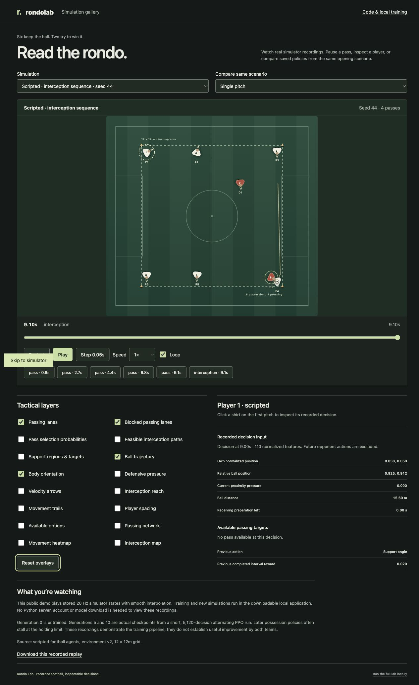

# Public simulation demo

Published at [prithvi-kaizen.github.io/rondo-lab](https://prithvi-kaizen.github.io/rondo-lab/). The repository uses GitHub Actions as its Pages source.

The `demo` build is a standalone static website. It uses the same pitch interpolation and decision inspector as the local lab, but loads committed recordings from `frontend/public/demo`. It never requests `/api`, starts training, or loads model weights. The full local application remains the normal build.

```bash
npm ci --prefix frontend
npm run build:demo --prefix frontend
python3 -m http.server 4173 --directory frontend/demo-dist
```

Relative asset URLs support GitHub Pages project paths and other static hosts. The demo includes three scripted scenarios and G0/G5/G10 possession checkpoints against the scripted cover/press opponent. All checkpoint comparisons share seed 42 and the default v2 configuration. Ended recordings hold their final state while the other pitch continues. The short policies' holding-limit failures are explicitly described.

The committed catalog records checkpoint filenames, actual decision steps, generation, outcomes and SHA-256 fingerprints. To regenerate from the existing local release weights:

```bash
uv run python scripts/export_demo.py
```

This requires the actual `experiments/v2-release` files described in the README. A fresh checkout can build and host the committed recordings without Python or those weights. Export validates replay schemas and rejects machine-local path leakage. Recorded positions, observations and events remain intact; JSON is compacted without downsampling or inventing states.

`.github/workflows/pages.yml` builds on main pushes and deploys through GitHub Pages Actions. Enable **Settings → Pages → Source: GitHub Actions** on the target repository. A workflow dispatch can redeploy without changing recordings. The regular CI workflow independently checks the full lab.

Browser QA: the production static build was served from port 4173, independently of the API. Checked initial scripted animation, actual saved-policy comparison, playback/stepping/scrubbing/event jumps, overlays and responsive overflow. Design direction remains pitch-first with restrained turf, white, red and lime; ENERGY 2 / RHYTHM 2 / MOTION 3. No claims of training improvement or browser FPS are made.

Design gate: hard gate PASS (keyboard controls, loading/error states, source-backed recordings and 390px overflow check); purpose gate PASS (turf and team colors retain football meaning); liveliness PASS (pitch focal point, restrained accent and recorded movement); craftsmanship PASS (both builds and actual scripted/checkpoint browser playback verified, no console errors).



Deployment verified on 3 November 2026: public project-path assets and catalog loaded in the browser. Scripted and actual checkpoint playback were checked on the hosted URL. The initial build ran before Pages was enabled; retrying after enabling Actions hosting resolved that setup failure.
