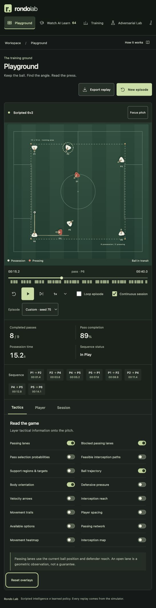
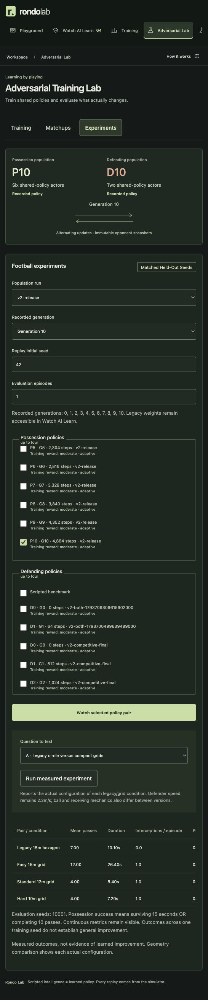

# V2 verification

Verified locally on 3 November 2026, macOS / Apple Silicon. Training used CPU. This record supersedes the historical v1 verification.

## Checks

- `pytest -q`: **28 passed** in 16.43s. Includes Gymnasium/PettingZoo validators, relative swept collision, hidden-intention exclusion, basic carrier-only actions, masks/rewards, immutable frozen opponents, population sampling, alternating updates, actual checkpoints, deterministic same-runtime resume, legacy playback, matched evaluation, API pause/resume and measured experiment duration.
- `ruff check .`: passed.
- `npm run build --prefix frontend`: TypeScript and Vite production build passed.
- One third-party Starlette/httpx TestClient deprecation warning remains.

## Actual football and training

The original scripted drill completed 16.2 passes on average with zero interceptions across seeds 42–51. Final v2 completed 9.6 passes with 0.7 interceptions per episode, 17.855s mean duration, 3.77m nearest-defender distance and 41.8% adjacent passes. Defender speed remained 2.3m/s. Ten held-out seeds 10001–10010 produced 9.8 passes, 19.045s duration and 0.7 interceptions per episode. No swept-flight tunnelling candidates were detected in the ten initial scenarios. These are small diagnostic samples, not a balance guarantee.

`experiments/v2-release` contains a real 5120-decision alternating PPO run, 20 update blocks, and ten generations per team. Generation 0 is saved before optimization; generations 5 and 10 are actual saved actors. Fixed benchmark evaluation uses the original drill and cover/press defenders, independently of sampled historical training opponents. Curriculum and historical results are separately recorded. Fixed-team 512-decision runs and nine G0/G5/G10 matchups across five held-out seeds are recorded in [V2_EVALUATION.json](V2_EVALUATION.json). Generated weights stay outside Git.

**Useful bilateral learning was not established.** Later possession actors frequently make no pass and lose at the holding limit around 3.05 seconds. Defenders intercept earlier neural possession but generalize poorly to scripted possession. The matrix exposes duration, interceptions, pressure, passing distributions and stalling flags so these failures remain visible. A terminal holding-limit loss is not counted as a defensive interception or tackle. More training and multiple independent training seeds are required before making quality claims.

## Browser verification

Verified in the actual browser at localhost:5173:

- Scripted v2 6v2 starts without weights, animates continuous ball/player movement, receives and intercepts, terminates naturally and advances to another seeded episode in continuous mode.
- Real v2 saved possession/defending pairs, generation selection, synchronized split-screen comparisons and legacy v1 4096-step replay load. Legacy playback retains 90 features; v2 inspection reports 110 features.
- Playback, pause, restart, frame stepping, speed, timeline scrubbing and event jumps operate on recorded states. Tactical controls expose actual lanes, trajectories, regions, targets, pressure and feasible interception paths. Neural inspection displays recorded probabilities/value estimates; scripted policies show their absence explicitly.
- Training start, cooperative pause/save and session resume were exercised through the UI. A small resumed run completed at 64 total steps. Stop/conflict/invalid-session paths are covered by API tests.
- Actual checkpoint matrix displayed P10/D10's zero-pass holding-limit outcome. Geometry experiment returned four real conditions; a discovered missing duration field was repaired and verified at 10.10s / 26.40s / 8.40s / 7.20s for held-out seed 10001.
- Phone 390×844 and tablet 768×1024 layouts had no horizontal document overflow. Desktop viewport override was restored. Final browser error log was empty. No numerical FPS or physical-phone touch benchmark is claimed.
- Development servers were left running after QA.

## Design delivery gate

- Hard gate PASS: rendered pitch/control states, keyboard activation, loading/error/empty states and 390/768px overflow checks were inspected; all displayed results derive from simulator or checkpoint records. Existing contrast checks record muted text 7.36:1, accent 11.01:1 and defender numbers 4.74:1. No fictional endorsements, compliance claims or learning stages.
- Purpose gate PASS: turf stripes identify football space, shadows separate moving objects from turf, and charts represent recorded metrics. System typography supports dense tactical reading. Navigation and controls serve the supplied product brief.
- Liveliness PASS: ENERGY 2 / RHYTHM 2 / MOTION 3; the pitch is the focal point, lime marks actions/selection, red distinguishes defenders, and movement follows recorded football. The brief supplied the design direction; the user selected applying antislop during implementation.
- Craftsmanship PASS: production build, 28 tests, keyboard operation, responsive checks and actual scripted/saved-policy playback passed. Weak training remains explicitly labeled and inspectable.

## Limits

Toy steering physics, assigned support regions without full position exchanges, shared physical profiles, no aerial play/stamina/biomechanics and no learned continuous pass strength. Tactical metrics are defined proxies. CPU resume is verified within the same runtime; cross-device bitwise equivalence and GPU performance are unverified. Session population paths refer to retained immutable local files; moving experiments requires retaining or relinking those paths. Cooperative stop completes a block; abrupt termination can lose the current incomplete block. Older prototype experiments remain archived and should not be mixed with the finalized release benchmark.
