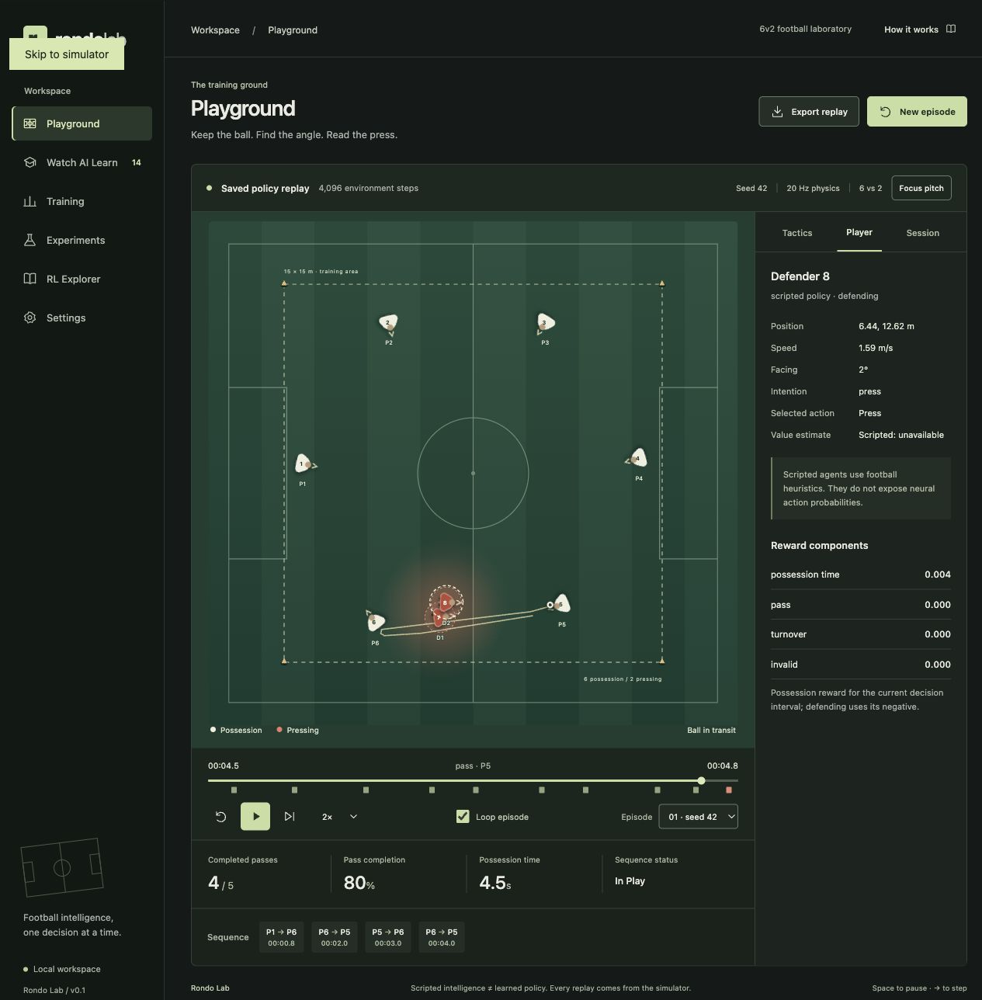

# Verification record

Verified locally on 3 November 2026, macOS / Apple Silicon, Python 3.13.5, Node 24.11.1. CPU training; no GPU required.

## Automated checks

- `python -m pytest -q`: **15 passed**. Includes Gymnasium `check_env`, PettingZoo `parallel_api_test` and `parallel_seed_test`, deterministic trajectories, ball travel/deceleration and no release/reception jumps, swept interception, boundaries, speed/turning/collision limits, masks, rewards, terminations/truncations, PPO loss/GAE/finite gradients, actual training, save/load, evaluation immutability, replay/API validation and subprocess cancellation/conflict handling.
- `ruff check .`: **passed**.
- `npm --prefix frontend run build`: **passed**, TypeScript and Vite production build.
- One third-party deprecation warning: the installed Starlette version deprecates its httpx-backed TestClient in favor of httpx2. Tests still pass; runtime is unaffected.
- `./scripts/dev.sh`: verified after stopping the separate development processes. Both servers started successfully; configuration, episode generation, policy inventory and experiment requests returned HTTP 200.

## Real training runs

| Run | Decision steps | PPO updates | Teams updated |
|---|---:|---:|---|
| possession-smoke, basic | 4096 | 16 | Possession |
| adaptive-smoke | 512 | 2 | Possession, including support decisions |
| pressing-smoke | 1024 | 4 | Pressing |
| competitive-smoke | 1024 | 4 | Possession and pressing, alternating |
| Browser-started possession job | 512 | 2 | Possession |

These runs saved genuine random initialization, intermediate and final weights under `experiments/`. They are local generated artifacts, excluded from Git. Recreate them using README commands on a clean clone. Final is a provenance label, not a claim that a policy is strong. Competitive checkpoints show global environment-step counts; individual teams update only on their alternating turns.

Evaluation on the same ten held-out scenario seeds, 10001 through 10010:

| Policy | Mean completed passes | Completion | Mean duration |
|---|---:|---:|---:|
| Random neural initialization | 2.0 | 69.0% | 4.63s |
| PPO after 4096 steps | 3.1 | 73.8% | 3.88s |
| Random actions | 1.5 | 57.7% | 3.67s |
| Simple heuristic | 7.2 | 84.7% | 13.95s |
| Advanced heuristic | 14.7 | 90.2% | 19.98s |

The final PPO policy remains weak and has shorter possession duration than its initialization. The small increase in passing count is not evidence of a reliable strategy or statistical superiority. This is one training seed and ten evaluation scenarios, not repeated independent training runs. Full observed outputs, including seed variation and approximate confidence intervals, are in [evaluation-smoke.json](evaluation-smoke.json). Per-update chart evaluations use only two fixed seeds and can remain flat even while weights and probabilities change.

## Scripted and saved-policy episodes

- Default scripted seed 42: **40.00s**, 32 completed / 33 attempted passes, all six possession players involved. Time-limit ending. A poor reception/recovery explains the additional unsuccessful attempt.
- Saved 4096-step PPO policy, seed 42: **4.75s**, 4 completed / 5 attempted passes, ending with an actual defensive interception at 4.70s.
- Random-action episodes at seeds 0, 1, 2, 4, 5, 6, 7 and 8 produced interceptions. Events come from swept physics tests, not scheduled animation.
- Both CLI recordings were regenerated with the documented demo/replay commands. Exported recordings remain watchable without model weights.

## Browser interaction evidence

Used the actual local app at 127.0.0.1:5173 with FastAPI at port 8000. No mocked API responses or browser-only football simulation.

| Interaction | Observed result |
|---|---|
| Fresh launch | Scripted 6v2 generated automatically and played without training |
| Pause, play, restart | Paused state persisted; restart returned to the start and resumed; completed episodes stop |
| Frame step | Timeline advanced exactly 0.05s; ball moved from (1.4747, 7.4544) to (1.6706, 7.9145) during the opening scripted pass |
| Timeline Home and event markers | Home sought to 0; frame step then showed 0.05; pass/reception/interception markers sought to recorded timestamps |
| Speed and loop | 2× selected and confirmed through live DOM value; loop enabled and replay returned through the episode repeatedly |
| Episode selection | Episode 02 generated seed 43, confirmed in recorded session metadata |
| All tactical switches | Passing lanes, trajectory, orientation, pressure, velocity, interception reach, trails, spacing, options, network, heatmap and interception map toggled; reset restored defaults |
| Player selection | Opened real position, speed, facing, intention, action and controller details |
| PPO inspection | Opening decision exposed actual probabilities (e.g. 26.8% for pass to 6) and value 1.108; scripted defenders explicitly showed neural quantities unavailable |
| Saved-policy selection | Actual possession-004096.pt replay played, with its terminal interception |
| Policy comparison | Initial and final checkpoint IDs appeared on separate pitches, synchronized by one time control from seed 42 |
| Pitch focus | Removed surrounding navigation/panels, kept pitch and playback separate; fixed an SVG intrinsic-sizing overlap found during QA |
| Phone 390 × 844 | Pitch and eight players fit; no horizontal page overflow after fixing navigation minimum width; navigation scrolls within its own row |
| Tablet 768 × 1024 | Eight players present; no horizontal page overflow |
| Desktop 1280 × 720 and 1280 × 900 | Pitch resizes; focus mode keeps playback below the SVG; no horizontal page overflow |
| Real settings | Width changed to 25m and defender speed to 7m/s; Apply generated a new 25 × 15m episode |
| UI training start | Separate process reported running, then completed at 512/512 steps with two real updates and logged evaluation |
| UI training stop | Keyboard-operated Start and Stop terminated a new job; monitor subsequently reported cancelled |
| Experiment comparison | Selected possession and pressing runs; chart switched to their actual completion data |
| Replay export | Browser downloaded rondo-43.json |
| Replay import | Selected examples/saved-policy.json through the actual file picker; imported replay showed Saved policy replay and 4096 steps; no checkpoint loading needed |
| Browser logs | Fresh final browser session had no error/warning messages; an earlier development-only duplicate-root warning was fixed by separating App from the root entry point |

Remaining repetitive settings controls and educational accordion content were checked against their handlers/source rather than claiming every slider permutation was clicked. Overlapping-job rejection and process cancellation were also verified by API lifecycle tests. Default and saved-policy playback were observed in the browser with interpolated motion, and recorded ball displacement was checked numerically. No quantitative FPS benchmark or physical-device touch test is claimed.

Browser approval infrastructure temporarily delayed a checkpoint selection and a file-picker action; retry succeeded. These were tool delays, not application errors.

## Visual evidence

## Delivery review

The pitch is the primary visual surface. Dark framing follows the brief; pitch stripes represent turf, shadows separate shirts/ball from the pitch, and overlays derive from geometry/events. No fabricated learning curves, policy stages or tactical claims. Core foreground contrast checks: muted text 7.36:1 on panel, lime accent 11.01:1 on panel, defender numbers 4.74:1 on red shirts. Controls have visible keyboard focus. Frontend source is formatted with Prettier. Physics/RL/API code passes Ruff.
